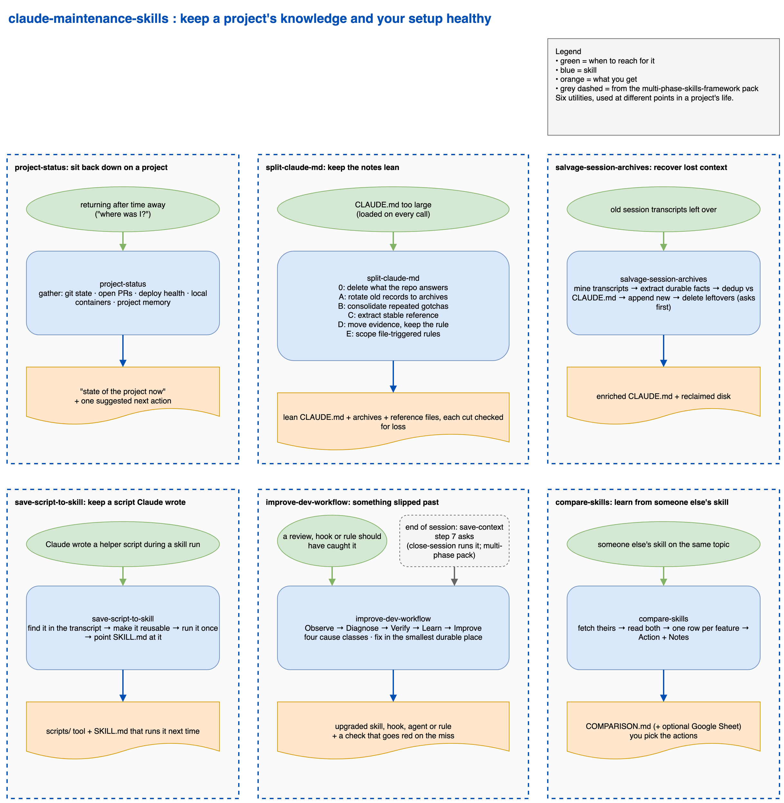

# Claude Code maintenance skills

Six Claude Code skills for keeping a project's knowledge and your Claude Code setup healthy over time: orient yourself when you come back to a project, keep its `CLAUDE.md` from bloating, recover anything useful left behind in old session transcripts, turn a helper script Claude wrote into a permanent tool of a skill, improve the development workflow when something slipped past it, and compare one of your skills with somebody else's.

Each skill is a self-contained directory (a `SKILL.md`). Claude can invoke one when its description matches what you are doing, or you can ask for it by name.

## When each one runs



Source: [docs/maintenance-flow.drawio](docs/maintenance-flow.drawio) (editable in draw.io).

## The skills

- **`project-status`**: cold-start orientation for a project. Gathers git state, open PRs, deploy health, local container status, OpenSpec change progress, unresolved review blockers, and pending items from project memory, then synthesizes a "what is the state of this project right now" report and suggests one next action. Read-only; it never mutates git, the deploy, or your files. Use it when you sit back down on a project after time away.
- **`split-claude-md`**: six-phase `CLAUDE.md` maintenance for a file that has grown too large. Phase 0 deletes what the repository itself answers. Phase A rotates old dated records into monthly archives with an index. Phase B consolidates recurring failure patterns. Phase C extracts stable reference sections to sibling files. Phase D keeps a rule in place and moves only its evidence out, which is the one cut that does not delete a rule. Phase E scopes file-triggered rules to `.claude/rules/` so they leave the always-loaded set entirely. Ships `survey.py`, which measures the file and prints the candidates for phases 0, C, D and E, and `rotate.py` for the Phase A move. No-loss checks run around every cut: `loss_check.py` says where each rule sentence, heading, path and command of the old file went, `pointers.py` confirms every pointer still resolves, and `recall_check.py` asks a fresh session the same questions before and after the split. `rotate.py --undo` restores a run, and `run_tests.py` runs the skill's test suite. The skill body is a short driver; each phase's detail lives in `split-claude-md/reference/`, so a compaction cannot truncate it.
- **`salvage-session-archives`**: mine the Claude Code session-transcript leftover folders for a project, extract durable facts, decisions, and gotchas that never made it into the project's `CLAUDE.md`, cross-check them against what is already documented (duplicates and contradictions), append the genuinely new items under a "Salvaged from session archives" section, then delete the leftover folders. Recovers lost context and cleans up disk in one pass. It asks before deleting anything.
- **`save-script-to-skill`**: after a skill run where Claude wrote a helper script to finish the job, moves that script into the skill's `scripts/` folder and rewrites the skill's `SKILL.md` so the next run executes the file instead of writing it again. Ships `find_session_scripts.py`, which reads the session transcript to find the skill invoked last and every script written or run after it. It makes the script reusable (arguments instead of session values, no secrets, clear exit codes), runs it once on the same input, and asks when more than one script could be the one.
- **`improve-dev-workflow`**: the continuous-improvement loop for the development process itself. When something reached you or a reviewer that a skill, hook, agent or rule should have caught, it runs Observe, Diagnose, Verify, Learn and Improve: it reads the session transcript, lists each incident with quoted evidence, looks through four lenses (time lost finding things, checks that already exist, tool cost, missing access to a log or service), sorts each cause into one of four classes (process, missing context, weak rule, unreliable code), and fixes it in the smallest place that loads by itself next time. An improvement is done only when each fix has a check that runs and goes red on the miss (a hook, a test, or a replay of the original incident), or is recorded as words-only with the reason. Each step ends on a "Done when" line. `save-context` step 7 (in the multi-phase-skills-framework pack) asks at the end of a session whether to run it, so `close-session` reaches it too.
- **`compare-skills`**: compares one of your skills, commands or agents with somebody else's on the same topic, feature by feature. It fetches theirs from a GitHub link or a path (with the files it depends on), reads both in full, writes one row per feature with an action for you to confirm (Enhance, Change, Keep mine, Nothing to do) and a note saying what the change would be, and saves the table as `COMPARISON.md`. A Google Sheet with a dropdown per row is optional. It recommends and never edits either skill.

## Install

Each subdirectory here is a self-contained skill. Copy or symlink the skill directories into your `~/.claude/skills/` so Claude Code picks them up:

```bash
cp -R claude-maintenance-skills/project-status \
      claude-maintenance-skills/split-claude-md \
      claude-maintenance-skills/salvage-session-archives \
      claude-maintenance-skills/save-script-to-skill \
      claude-maintenance-skills/improve-dev-workflow \
      claude-maintenance-skills/compare-skills \
      ~/.claude/skills/
```

## Assumptions

These skills assume the standard Claude Code layout: a per-project data directory at `~/.claude/projects/<X>/` holding an optional `CLAUDE.md` and a `memory/` folder, and the dash-encoded transcript "leftover folders" Claude Code creates under `~/.claude/projects/`. All paths derive from `$HOME`, so the skills work on any machine without editing. `project-status` also reads a repo-root `CLAUDE.md` when one exists.

## Optional integrations (not bundled)

`project-status` checks several things when the tool or file is present and skips them silently otherwise. None are required:

- `git` and the GitHub CLI (`gh`) for branch state and open PRs.
- A deploy host (for example Render) and local Docker, for deploy and container health.
- OpenSpec for change-progress tracking; it is a separately installed tool (`npm install -g @fission-ai/openspec`) and `project-status` will suggest `/opsx:apply` only when an OpenSpec change with open tasks exists.
- A `COMMENTS.md` review file, read for unresolved blockers when one is present.

`compare-skills` uses the GitHub CLI (`gh`) to fetch a skill from GitHub. Its optional Google Sheet needs `google-api-python-client` and `google-auth-oauthlib`, a desktop OAuth client from your own Google Cloud project with the Sheets API switched on, and a one-time sign-in with `compare-skills/scripts/mint_sheets_token.py`. The markdown table needs none of these.

The session-lifecycle skills that pair naturally with these (`save-context`, `close-session`, `todo`, `new-session`) live in the separate multi-phase-skills-framework pack, so they are not duplicated here. Its `save-context` step 7 is what calls `improve-dev-workflow` at the end of a session, and its `rules/improve-dev-workflow.md` is the standing rule for when to run it mid-session.

## Conventions

- `project-status` and `salvage-session-archives` (before its final confirmed deletion) are read-only orientation passes. `split-claude-md` restructures `CLAUDE.md` locally and does not commit or push.
- Writing follows plain-prose conventions: no em dashes, no marketing adjectives, no Unicode box-drawing characters in tables.

## Credits

`improve-dev-workflow/reference/agent-writing-checklist.md` is written in my own words from the ideas in the `writing-for-agents` skill by Matt Pocock ([mattpocock/skills](https://github.com/mattpocock/skills), MIT).

## License

MIT. See [LICENSE](LICENSE).

## Model routing

The skills in this pack pin a Claude Code model alias in their frontmatter, so each artifact runs on the tier its work needs:

- `model: inherit`: planning and judgment-heavy review. These run on your session model, so start a planning or review session on your strongest model (switch with `/model`).
- `model: opus`: execution and content work
- `model: sonnet`: routine or mechanical steps

If a pinned model is not available on your plan, or you prefer different routing, edit the `model:` line in the artifact's frontmatter, or delete it to inherit your session model.
